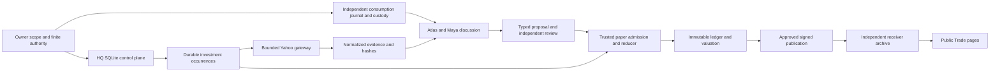

# Architecture, infrastructure and safeguards

This review combines current source, live read-only metadata and retained acceptance. It is not a penetration test, a provider invoice audit or destructive disaster-recovery exercise. [System inventory](SYSTEM-STATUS.md) pins identities and evidence; [findings](FINDINGS.md) records open risks.

## Control and data flow

The diagram shows an implemented path, not a claim that the genuine October 14 chain completed. The actual break is between discussion and typed proposal. The next-day rolling admission problem was earlier, at scheduling; PR 100 is now deployed, with genuine next-day acceptance pending. No brokerage edge or adapter exists in the reviewed investment path.

## HQ and employee execution

`Company` owns domain services over operator-controlled SQLite. WorkingGroups hold durable charter, membership, evidence, contributions and synthesis; Conversations own execution/session context; InvestmentLoop binds occurrences to requests/executions; Dispatcher shares two global slots with one investment slot. Worker, Unix binding, workspace, provider thread and execution IDs remain distinct. Native tools are not enabled merely by a worker's title.

The investment scope selects Atlas and Maya. Proposal authors/submitters and independent reviewers are checked in trusted code against execution identity and exact proposal hash. Evidence read receipts and scope checks prevent an unread or withdrawn source from being cited as delivered. The finite worker tool surface includes bounded record reads, structured discussion and paper tools; unrestricted shell/network/MCP/broker credentials are absent. Prompt text cannot extend immutable scope, role, deadline or budget.

Source: `src/control/company.ts`, `discussions.ts`, `conversations.ts`, `dispatcher.ts`, `investment-team/`, `investment-loop/service.ts`, `usage/finite-hq.ts`, `runtime/finite-policy.ts`. Generic operator capabilities elsewhere in HQ do not authorize them in investment turns. The eight workers have connected execution history; this audit does not certify every staff capability or infer that all eight research investments.

## Provider, telemetry and failure isolation

Production uses Node 24.21.0, Codex CLI 0.157.0 and the finite `gpt-6-sol` profile. `src/runtime/codex.ts` opts fresh `thread/start` into experimental raw response events. The pinned cold-resume interface cannot request those options. Maya's fourth morning turn cold-resumed and exposed cumulative diagnostics without authoritative per-response usage. The deployed prevention change starts fresh finite sessions from durable discussion and rejects resumed finite bindings before CLI work. Ordinary conversation resume remains separate.

Three genuine recovery turns after the prevention deployment each have complete authoritative usage. The old Maya record remains incomplete, consumed and attributable. Decision 052 accepts that exact historical gap only, binds the predecessor and successor, and caps the family at 11 attempts. Unknown outcomes, additional incomplete usage, account/routing drift, unavailable custody and provider denial remain fences. This is bounded mitigation, not reconstruction of missing tokens or a guarantee that telemetry never fails again.

Independent finite custody survives a Company database restore. Reservation precedes transmission, consumption is not refunded by a failed outcome, and canonical checkpoint disagreement fails closed. Startup recovery and live publication restart have distinct checks. The merged rolling calculation is read-only and does not clear a hold, attest reload state, reserve a turn or extend a research window. See [validation](VALIDATION.md).

## Market evidence and reproducibility

The approved universe is AAPL, MSFT, GOOGL, AMZN, JPM, JNJ, XOM and WMT, with SPY as benchmark. Yahoo direct-chart acquisition passes through a fixed Python 3.12.12/yfinance 1.7.0 adapter and trusted bounded gateway. Existing constraints include 5-second spacing after settlement,262,144-byte response limit,10-second wire timeout and 120-second adapter deadline. Request hashes and independent one-use custody prevent replay; an uncertain attempt is not refetched to satisfy an audit.

Nine genuine morning responses contain seven daily bars each for Oct 5–13. Each normalized evidence hash verifies under the repository's canonical JSON-string hashing. They correctly fail current-session qualification with `missing_session`. Provider-retrieval time, market-effective time, source availability and accounting time are distinct. Raw body discard limits byte-for-byte future reparsing; retained request/content hashes, normalized values, evidence IDs, timestamps and delivered packet provide decision traceability, not recovery of discarded Yahoo bytes.

`src/domain/market/observed-paper.ts` validates same-session unadjusted OHLC, instrument/currency/timezone/venue, provider trading period, calendar coverage and corrections. Missing or stale evidence cannot silently become a fill. Corporate-action extraction supports qualified splits/dividends; unknown payment dates do not become invented dividend cash. General security lifecycle events, every tax treatment and every vendor revision are not certified. The stored calendar covers 2026; later years need prospective reviewed support. Internal `verified` means a same-session snapshot accepted under the approved methodology, not independently established exchange finality. Provider publication time remains null and no final-bar flag is enforced. The close amendment’s five-minute collection and twenty-minute processing delays are elapsed-time safeguards; they do not independently certify a vendor’s final close (BSIA-013).

The official [NYSE hours/calendar](https://www.nyse.com/trade/hours-calendars) lists core 9:30–16:00 Eastern and the 2026 holiday schedule. Oct 14–15 are ordinary sessions in the retained calendar, consistent with those published rules:13:30–20:00 UTC. This is a calendar cross-check; it is not a fresh quote or a guarantee of data availability. Owner-reported Yahoo permission and Decision 029's US $0 incremental source budget remain unchanged.

## Paper engine and financial boundaries

The fixed-point reducer in `src/domain/investment/` is shared by synthetic and observed façades. Typed proposal, exact independent review, submission, locked cash/position, qualified price, fill and immutable transaction are distinct records. Idempotent command keys and journal hashes prevent duplicate effects. Long-only/no leverage,15% position,35% sector,5% minimum cash,2 orders/session,6/week,10bps slippage and zero commission are configured. Price guards, minimum cash and source/publication health can deny an otherwise reviewed order.

Normal `inv-real-open-v1` uses a precommitted next regular OPEN, collected after that session's close; it is delayed modeled execution, not a real-time broker order. Decision 052 adds a prospective Oct 14-only CLOSE amendment with 19:30 cutoff. The engine cannot convert the earlier provisional discussion into an order after that cutoff. Benchmark SPY allocation has a separate ledger and is not an employee portfolio trade.

Portfolio initialization remains $100,000. At the first audit checkpoint cash is 100000.000000, reserved cash 0, holdings empty, realized 0, no orders. Initialization's internal complete snapshot means its arithmetic is known; it does not establish session performance. Public projection appropriately withholds comparable performance until supported observations/accounting exist. No real brokerage SDK, account credential, submission route or worker brokerage tool was found in this path/dependencies. This is evidence about the reviewed implementation, not an assertion about every service on the hosts.

## Publication and public/private separation

HQ owns canonical `contracts/investment/v1/`; the website owns signed receiver/archive/UI. Receiver installed source pin `fbd26f520e7403a469643ed350df5e08bbc1ec2b`, manifest `ff9c457580475583614541b76d9f0267ac2a15afff0f87f955acdff5f063e081`, all 9 package files verified. Producer generation and private successor generation are independent; public generation remains 1.

Reviewed authentication uses RFC9421 Ed25519 with method/authority/path/body digest, current publisher/key/scope, finite quotas and durable replay nonces. Strict framing rejects ambiguous requests. Short immediate SQLite transactions atomically record immutable events, projections and receipts; WAL/FULL/FK are configured. Readback verified eight canonical hashes, receipt IDs/digests and progressive watermarks. It did not retrospectively replay original HTTP signature bytes. Public status/no-cookie/no-store behavior was checked by the owner on 13 HTTPS GETs.

Only approved structured summaries and financial projections cross the public boundary; raw private transcripts, source bodies, credentials and operating controls are not public exports. Current UI shows Live Trading Desk, Trade navigation, “This trading experiment,” no hero aside, retained legacy/evidence routes and honest missing data. Reused 390/768/1440 browser evidence verifies layout, keyboard focus and no console errors; screen-reader/device certification remains unverified. Existing money/paper disclosures are necessary to this audit's truthfulness requirement; older unrelated copy preferences are not a readiness blocker.

## Hosts, persistence and recovery

| Surface | HQ | Website/receiver shared host |
|---|---|---|
| OS | Ubuntu 24.04.5 LTS, kernel 6.8.0-142 | Ubuntu 22.10, unsupported retained exception |
| Runtime | Node 24.21.0; Python 3.12.12; Codex 0.157.0 | Node 22.23.1 |
| Disk available | Approximately 22 GB |6,583,078,912 bytes; only 140,627,968 bytes above 6 GiB deployment floor |
| Memory |1.97 GB total, about 1.49 GB available; HQ about 216–218 MB |1,003,409,408 bytes total;317,915,136 bytes available;182,341,632 bytes swap used |
| Database | schema 29, WAL, quick check ok, FK 0, mode 0600 | migration 2, WAL, quick check ok, FK 0 |
| Service confinement | Dedicated service identity, strict filesystem, protected home, no new privileges, private tmp, core 0, no swap; memory maximum unlimited | Dedicated receiver/Ask identities, strict filesystem/no new privileges/private tmp; receiver 256 MiB+64 MiB swap; Ask 192 MiB/no swap/tasks 32 |
| Listener | HQ 127.0.0.1:4310; SSH 22 | Receiver/Ask behind existing ingress; Ask 127.0.0.1:3102 |
| Restart | HQ NRestarts 0; retained restore/authority checks | Services NRestarts 0 at observation; retained receipt/replay controls |

HQ protected directories are 0700, Company database and central authentication file 0600; only metadata was inspected. Ask key file is absent. Source deployment is root-controlled. No credential contents were copied into audit evidence. Permission and sandbox inspection does not prove encryption at rest, cloud-account configuration or resistance to root compromise.

HQ has stopped same-host snapshots, latest guarded backup at `/var/backups/botsquad/investment-rolling-start-20261014T202624Z`, containing the completed head 16 close state. Website's stopped archive backup at `/var/lib/asymmetri-close-recovery-release-20261014/investment-data-before/archive.sqlite` passes integrity but holds 6 events versus 9 final live events. Neither establishes current off-host custody. No receiver backup systemd timer was found; cron/cloud policies remain unverified. Previous encrypted Mac receiver backups were removed under earlier owner cleanup. Git history cannot restore private databases, signing custody or spent allowances.

Rollback must preserve current immutable data and independent consumption/publication custody. A code rollback is not permission to restore an older database or reuse an allowance. Website rollback directory exists; older receiver code must first demonstrate amendment compatibility. Physical erasure, power-loss durability and current off-host restore are unverified. The unsupported OS and tight disk margin require owner/website infrastructure planning; no migration or cleanup was performed by audit. [Ubuntu lifecycle](https://ubuntu.com/about/release-cycle) documents the short interim support policy and 24.04 LTS support horizon.

## Ask isolation

Ask remains owner-paused. Listener installation is distinct from admission: admission/claims/delivery false, roster 0, generation 0/expiry 0, public availability disabled. Receiver sessions/conversations/questions/answers/claims/keys/receipts/audit all 0; three rate-limit quota entries are GET accounting, not inference. HQ 13 Ask tables and Ask usage are empty; no provider key exists. No probe, claim or activation was run. These records establish no Ask work in these deployed components; they do not certify account-wide billing outside them.

## Residual scope limits

No destructive live tests, privileged worker sandbox escape tests, genuine extra model probes, discarded-source re-fetches, invoice retrieval or off-host disaster restore were performed. Historical authored failures are not relabeled passes. The owner stopped the prior 15-minute chat monitoring automation and transferred coordination here; server-side investment scheduling remains active. No replacement monitor is created. Health alone is not end-to-end acceptance.

## Final close and deployment reconciliation

The host table above is the initial audit measurement. At 20:26:33 the owner-approved PR 100 release was ready on PID 872875/schema 29, with 180 unchanged tables and exact finite/financial preservation. [Final host metadata](evidence/host-postdeploy.txt) records root 0700 backup/0600 databases,22,337,624 KiB free, service memory 143,806,464 bytes/peak 174,514,176 and NRestarts 0. The protected same-host backup is current through valuation head 16; off-host recovery remains unverified.

All 18 retained source hashes verify and model usage stays 7. Actual source-qualified close accounting/valuation and public projection passed; [independent website receipt](evidence/website-close-receipt.json) verifies source 9/journal 1, original 8 prefix, nine receipts/hashes, complete valuation and accurate rendered pages. Receiver/website/Ask/ingress identities are unchanged. Public archive freshness remains unknown, availableAt remains null, and the portfolio transaction ledger is still initialization-only. This validates scheduled bookkeeping and publication, not the missing genuine employee decision/fill path.
