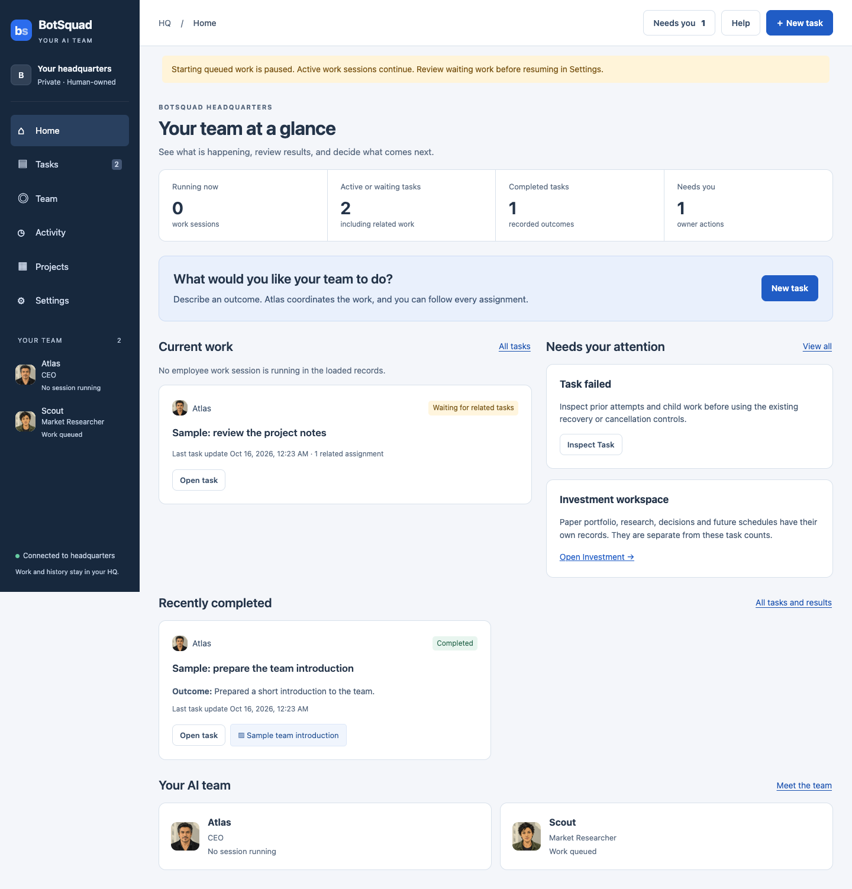
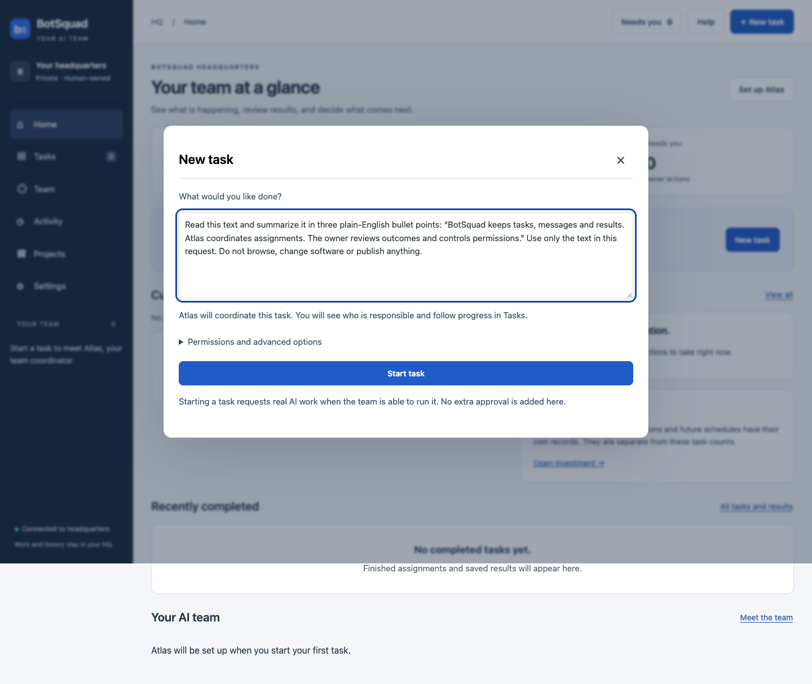
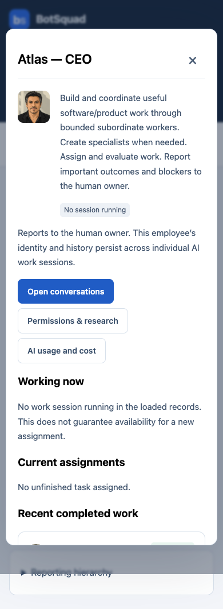
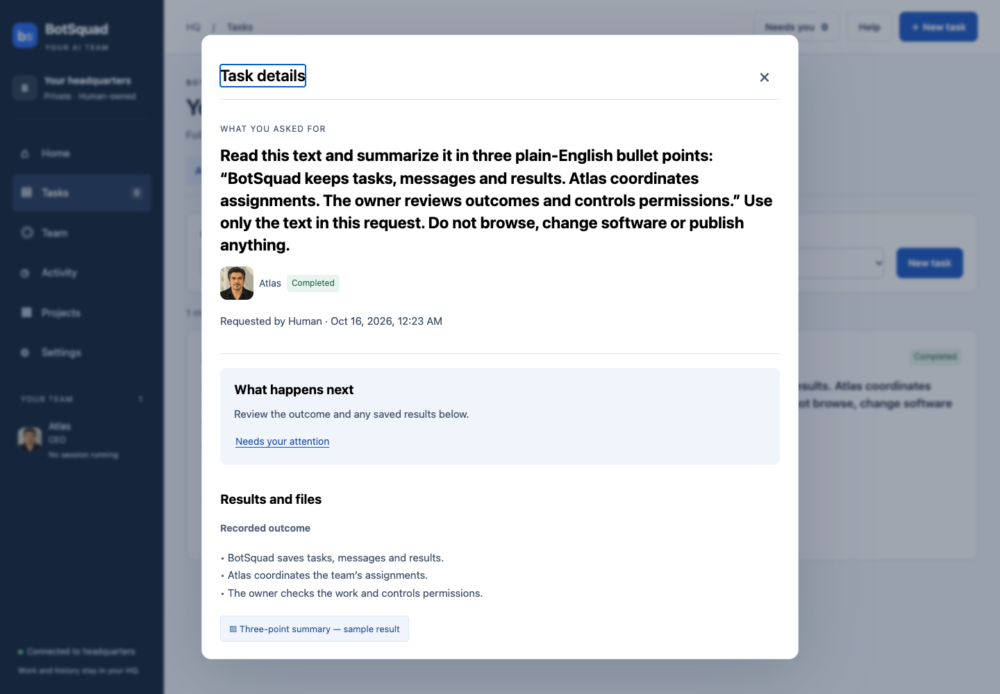
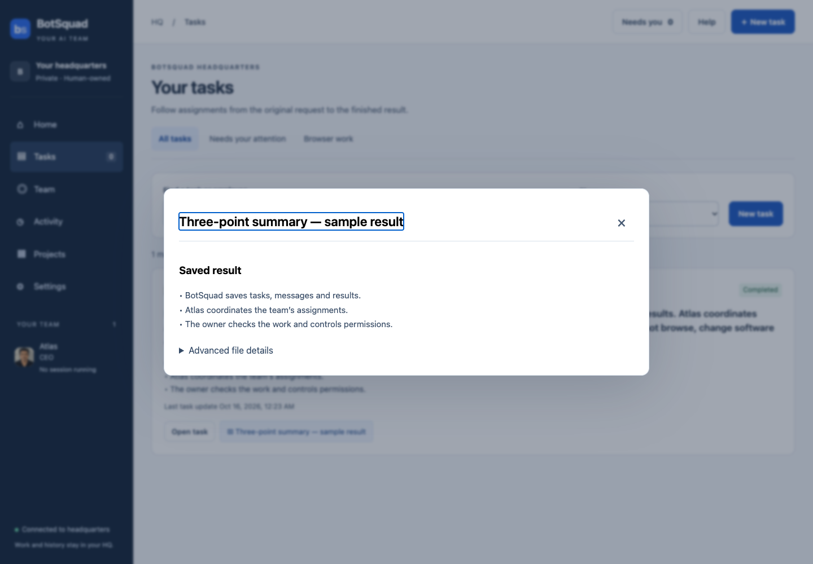

# Your First Task with BotSquad

Give your AI team a small job, follow its progress, and check the answer.

Open your private HQ using [the connection instructions](../operations/ACCESS_AND_OPERATIONS.md#open-the-botsquad-ui). BotSquad HQ is where you assign work and review your team's results. An **AI employee** is a persistent named team member with a responsibility. Atlas coordinates ordinary tasks; other employees may receive related assignments.

## 1. Start on Home

Home answers four questions: what is being worked on, what needs your attention, what finished, and who is on your team. A running **work session** means an employee is working now. An unfinished task may be waiting. Those counts measure different things.



*Actual HQ capture with isolated, explicitly authored sample records. The failure and results shown here are synthetic; they are not live investment or employee-performance evidence.*

The navigation has six destinations: **Home, Tasks, Team, Activity, Projects, Settings**. On a phone they appear above the page. Each destination has a smaller row of related views. **Needs you** in the header opens items requiring owner action. Ordinary waiting does not automatically require intervention.

If the team is paused, the page says so. You can still create a queued task. Before using **Settings → Resume queued work**, review other waiting tasks: resuming applies to the team, not just this exercise. You do not need to initialize Atlas separately; starting a task sets up the coordinator if necessary.

## 2. Tell the team what you want

Choose **New task** in the header or Home. In **What would you like done?**, paste:

```text
Read this text and summarize it in three plain-English bullet points: “BotSquad keeps tasks, messages and results. Atlas coordinates assignments. The owner reviews outcomes and controls permissions.” Use only the text in this request. Do not browse, change software or publish anything.
```



Choose **Start task** once. This requests real AI work under existing limits. No web research, document grants, software changes or publication are needed for this exercise. An existing runtime/account must be able to run work; the form does not create permission or funding. Advanced options explain those boundaries; no model or provider selection is needed here.

The task opens with your request and responsible employee. Atlas may do the work or create related assignments. The UI reports what actually happened; it does not promise a particular team or sequence.

If confirmation is lost, the form keeps your text and asks you to **Check Tasks** before trying again. If creation is confirmed but loading fails, it says **Task created** and provides **Open Tasks**. Find the existing task or retry loading HQ instead of submitting a duplicate.

## 3. Follow progress and the employee

Open **Tasks → All tasks**, find your description, and choose **Open task**. You can search by task text or employee name and filter completed or unfinished tasks.

The task shows **What you asked for**, the responsible employee, **What happens next** (or **What needs checking**), **Results and files**, **Recorded progress**, and **Related assignments**. Progress is based on recorded events, with dates and times. A completed work session does not necessarily finish the whole task.

| Status | Meaning / next action |
| --- | --- |
| Waiting to start | Queued; check the pause banner and existing eligibility/capacity. |
| In progress | The task is being worked on; read recorded activity. |
| Waiting for related tasks | Follow the related assignments; do not create another copy. |
| Waiting for approval | Open Needs you and review the exact request and scope. |
| Could not finish / Waiting · review reason | Read the reason and prior results before any retry. |
| Completed | The task is recorded as finished; read and evaluate its answer. |
| Cancelled | Closed; its history remains available. |

Choose the employee's name on the task, or **Team → Employees → Open profile**. Their profile shows their role, responsibilities, current assignments, recent completed work and recorded status. **No session running** does not promise that the employee is eligible or has nothing waiting.



*Phone capture from the same isolated sample exercise. No provider discovery is performed merely by opening a profile.*

## 4. Read and check the result

When the original task says **Completed**, open **Results and files**. Read the **Recorded outcome**. If a report was saved, select its title to open it. A saved file is optional; a readable recorded outcome may be the whole deliverable. Related assignments may have their own files.





*These are genuine browser captures of a disposable backend using an explicitly fake runtime. The response is authored for repeatable UI testing, not a claim of genuine AI execution. Your employee's wording and whether it saves a separate file may differ.*

Finish the exercise only after the task is completed **and** you can read three sensible points grounded in the supplied text. A label alone does not prove the answer is useful.

## 5. Find conversations and activity when useful

**Team → Conversations** opens direct employee conversations. **Open conversations** in a profile takes you there too. **Send passive message** saves context without requesting a reply; **Send & request reply** requests bounded AI work. Neither is the same as creating a task.

**Team → Discussions** contains working groups. Their recommendations do not automatically become tasks or formal investment decisions. [Learn about discussions](working-groups.md) separately.

**Activity → Recent activity** shows meaningful team milestones. **Team updates** retains the shared company messages and original assignment composer. **Work sessions** shows individual execution attempts and usage. **Advanced audit** retains every loaded original audit event. Task **Advanced details** exposes original identities, acceptance criteria, constraints and attempts. These are optional troubleshooting views.

## If something needs you

Open **Needs you**, read the explanation, and follow its source action. Review the exact request before approving. Permission, infrastructure, publication and business controls retain their original separate scopes; text in a task cannot grant authority.

If work fails, open the task and examine its reason, recorded progress, prior attempts, related work and saved results. **Retry inspected task** is offered only where the existing task policy permits it and requires acknowledging that review. Unknown provider outcomes can remain blocked. Do not repeatedly resubmit to make something happen.

If HQ disconnects, the connection indicator and loading banner explain that its records are stale. Mutating controls stay disabled until recovery. Use **Retry loading** to refresh. See [Access and Operations](../operations/ACCESS_AND_OPERATIONS.md) for service problems.

[Back to tutorials](README.md) · [Validation and evidence limits](../ux/hq-redesign/USABILITY-VALIDATION.md) · [Current terminology](../ux/hq-redesign/TERMINOLOGY.md)
